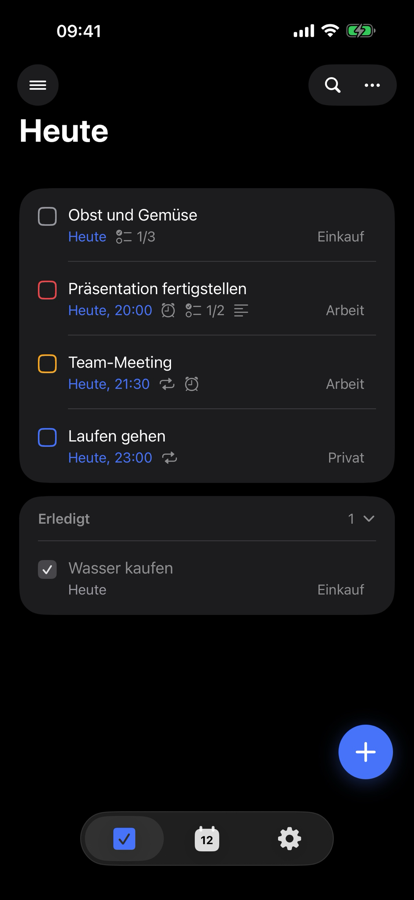
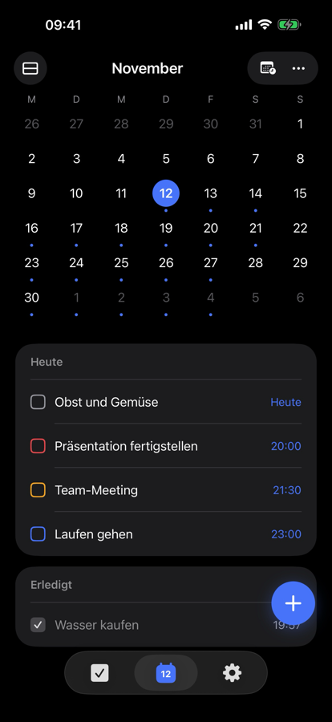
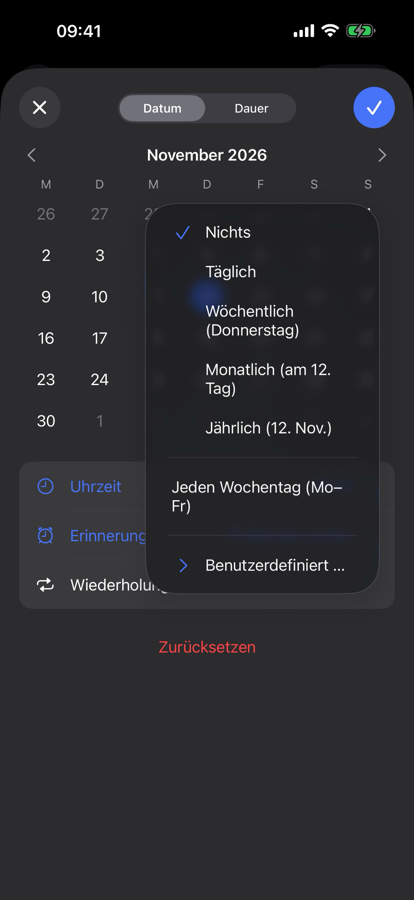

# Planer – Aufgaben & Kalender mit eigenem Server

> **Hinweis vorab:** Dieses Projekt wurde mit Künstlicher Intelligenz (Claude von Anthropic) erstellt.
> Der Code, die Texte und die Anleitung stammen von der KI, nicht von mir. Ich habe das Projekt
> angestoßen, ausprobiert und veröffentlicht – die eigentliche Arbeit hat die KI gemacht.

**Planer ist für alle, die ihre Privatsphäre schützen wollen.** Es ist eine Aufgaben- und
Kalender-App für iPhone, iPad und Mac. Anders als bei den meisten solchen Apps landen deine Daten
nicht bei einer Firma in der Cloud, sondern auf einem kleinen Computer bei dir zu Hause (zum
Beispiel einem Raspberry Pi). Von dort werden sie zwischen deinen Geräten abgeglichen.

- Kein Konto bei irgendeiner Firma
- Keine Werbung, kein Tracking, keine Analyse
- Deine Daten bleiben bei dir
- Funktioniert auch ohne Internet – Änderungen werden später abgeglichen

**📲 [Planer im App Store](https://apps.apple.com/de/app/id6834079614)** (iPhone und iPad, kostenlos; die Mac-Version ist in Prüfung)

<p>
  
  
  
</p>

## Was die App kann

- **Listen:** Heute, Morgen, Nächste 7 Tage, Eingang und eigene farbige Listen
- **Kalender:** Monats- und Wochenansicht mit allen Aufgaben des Tages
- **Termine:** Datum, Uhrzeit oder Dauer, mehrere Erinnerungen
- **Wiederholungen:** täglich, wöchentlich, monatlich, jährlich, werktags oder eigene Regeln
  (z. B. „alle 2 Wochen am Montag und Donnerstag“)
- **Schnelleingabe:** „Zahnarzt morgen 15 Uhr #gesundheit !hoch“ setzt Datum, Uhrzeit,
  Schlagwort und Priorität automatisch
- **Ordnung:** Prioritäten, Teilaufgaben, Schlagwörter, Notizen, Suche
- **Widgets:** Kalender mit deinen heutigen (und überfälligen) Aufgaben für den Home-Bildschirm,
  die nächste Aufgabe auf dem Sperrbildschirm neben der Uhrzeit
- **Heller und dunkler Modus**, Bedienung angelehnt an bekannte To-do-Apps

## So funktioniert es

```
 iPhone ─┐
 iPad   ─┼──►  dein kleiner Server zu Hause (z. B. Raspberry Pi)  ──►  speichert alles
 Mac    ─┘
```

Jedes Gerät hat eine eigene Kopie deiner Aufgaben. Sobald der Server erreichbar ist, gleicht die
App ab. Der Server ist ein kleines Python-Programm ohne weitere Abhängigkeiten.

## Einrichten

👉 **[Schritt-für-Schritt-Anleitung (auch ohne Vorkenntnisse)](docs/ANLEITUNG.md)**

Kurzfassung für Erfahrene:

```bash
sudo apt install -y git python3
git clone https://github.com/Minipliy/planer.git
sudo bash planer/server/install.sh
```

Danach in der App unter **Einstellungen → Synchronisation** die angezeigte Adresse und das Token
eintragen. Für den Zugriff von unterwegs empfiehlt die Anleitung Tailscale (verschlüsselt, ohne
Portfreigabe am Router).

## Aufbau des Projekts

| Ordner | Inhalt |
| --- | --- |
| `Planer/`, `Planer.xcodeproj` | Die App (SwiftUI, ein Projekt für iPhone, iPad und Mac) |
| `PlanerWidget/`, `Shared/` | Die Widgets und die Daten, die App und Widgets teilen (App Group) |
| `server/` | Der Sync-Server (`server.py`) und das Installationsskript (`install.sh`) |
| `web/` | Die Webseite planer.minipliy.net (`python3 web/build.py`) |
| `docs/` | Anleitung und Bilder |

### Wie der Abgleich technisch läuft

- Die App schickt alle lokal geänderten Einträge per `POST /sync` an den Server
  (`Authorization: Bearer <Token>`) und bekommt alles zurück, was sich seit dem letzten Abgleich
  geändert hat.
- Bei Konflikten gewinnt die zuletzt gespeicherte Änderung.
- Der Server speichert alles in einer einzigen SQLite-Datei (`/var/lib/planer/planer.db`).
- `GET /health` antwortet mit `{"ok": true}`.

## Lizenz

MIT-Lizenz – du darfst den Code frei verwenden, verändern und weitergeben. Siehe [LICENSE](LICENSE).

## Datenschutz

Die App selbst sendet nichts an den Entwickler. Sie verbindet sich nur mit dem Server, den du in den
Einstellungen einträgst. Details: <https://planer.minipliy.net/datenschutz>
